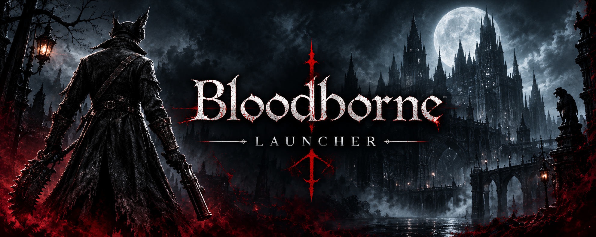

<div align="center">



# Bloodborne Launcher

A one-click Windows installer and launcher for the Bloodborne PC port.<br />
It downloads the game, the v1.09 update, the port, and the extractor from inside the app, then finishes the install itself.

<br />

<a href="https://github.com/furylemonss/bloodborne-launcher/releases/latest"></a>
<a href="#requirements"></a>
<a href="LICENSE"></a>
<a href="#license"></a>

<br />

<a href="https://v2.tauri.app/"></a>
<a href="https://www.rust-lang.org/"></a>
<a href="https://vite.dev/"></a>
<a href="#what-it-does"></a>

<br />

[Türkçe](README.tr.md) · [Download](#download) · [What it does](#what-it-does) · [Build](#build-from-source) · [License](#license)

</div>

---

## Download

Get the installer from the [latest GitHub Release](https://github.com/furylemonss/bloodborne-launcher/releases/latest).

| File | What it is |
| --- | --- |
| `Bloodborne Launcher_<version>_x64-setup.exe` | NSIS setup. This is the file most people should run. |
| `Bloodborne Launcher_<version>_x64_en-US.msi` | MSI package, for people who prefer Windows Installer. |

The setup only installs this launcher. It does not contain the game. After you open the launcher, pick a folder and start the install. The app downloads the rest and finishes the setup on its own.

---

## What this is

Most Bloodborne PC launchers expect the dump, the update, and the port to already sit in the right folders. This one does not. You install the launcher once and pick a target folder. The app downloads every file it needs, extracts them, applies the update, writes the port settings, and leaves you on the Play screen.

The launcher itself is small. The game data takes about 29 GB on disk. The download set is larger than that, because the PKG files and the extracted game sit side by side until you clean them up.

The project is open source. What is shared is the launcher code. The game, the update, the port, and the PKG extractor are not distributed with this repository. During setup each one is downloaded from its own existing public address.

---

## What it does

An install runs through nine steps. Finished steps are skipped the next time you open the app. A dropped connection does not start everything over.

| Step | What happens |
| --- | --- |
| Game PKG | The GOTY base package (about 29.2 GB) downloads from the Internet Archive. |
| Update PKG | The CUSA03173 EUR v1.09 update (about 173 MB) downloads. |
| Port | `Bloodborne-Windows.zip` from the latest port release downloads. |
| PKG extractor | ShadPS4Plus PkgExtractor 1.1 for Windows downloads. |
| Extract the game | The base PKG is unpacked into `downloads\CUSA03173` and the file tree is checked. |
| Extract the update | The update is unpacked into `downloads\CUSA03173-patch`. |
| Apply the update | The update is merged over the base game, then the patch is verified. |
| Extract the port | The port is unpacked into the `port` folder. |
| Write settings | Default launcher and port settings are written so the game can start. |

After that, Play launches `Play Bloodborne.exe`. If that file is missing it falls back to the port launcher, then to `Bloodborne.exe`.

---

## How this launcher is different

| | This launcher | A typical launcher |
| --- | --- | --- |
| Getting the game | One click inside the app | Download the PKG, patch, and port by hand |
| Extraction | Automatic, with a file-tree check | A separate extractor and a folder layout you have to get right |
| Update | Applied on its own | Copied or merged by hand |
| Interrupted download | Resumes from the partial file | Usually starts over |
| Interrupted install | Continues from the last finished step | Easy to leave a half-extracted tree |
| First-launch settings | Written for you | Fixed later in ini files |
| Window | Frameless app, tray, pause and resume | Usually a script or a tools folder |

The difference is not a new port. The game still runs through the existing Bloodborne PC port. This project only automates getting there.

---

## Requirements

- 64-bit Windows 10 or Windows 11
- About 65 GB of free space for a fresh install. An install that is already partly on disk needs less, because files already present are counted.
- A stable connection. The base package is about 29.2 GB.
- WebView2. Current Windows 10 and Windows 11 installs already have it. If the window does not open, install the [WebView2 Evergreen Runtime](https://developer.microsoft.com/microsoft-edge/webview2/).

The disk check runs before the pipeline starts. If the selected drive is too small, the install does not begin.

---

## Usage

1. Run the setup from Releases and open **Bloodborne Launcher**.
2. Choose the folder the game will live in.
3. Check the free-space figure, then start the install.
4. Let it run. You can pause, resume, or send the window to the system tray. Closing the window does not stop the download. The app stays in the tray.
5. When the pipeline reaches Ready, press Play.

Downloads are kept as `.part` files and resumed with HTTP range requests. A file that already matches the expected size is not downloaded again. If the connection drops, the same file is retried eight times before the step is marked failed.

Restarting a failed or paused install is safe. Finished steps stay finished. A half-extracted PKG is detected and cleaned before it is tried again. A cut-off game tree is not treated as done.

---

## Install layout

Everything stays inside the folder you chose.

```text
<install folder>
├── downloads
│   ├── Bloodborne.Game.of.the.Year.Edition.PS4-PRELUDE.pkg
│   ├── CUSA03173-EUR-Update-v1.09-PRELUDE-[PS4ID].pkg
│   ├── Bloodborne-Windows.zip
│   ├── CUSA03173 game files
│   └── CUSA03173-patch extracted update
├── tools
│   └── ShadPs4Plus-PkgExtractor-1.1-windows
├── port   PC port
└── installer-state.json   progress; the install resumes from here
```

Port settings are written in two places:

- `port\bbport.ini` holds the upscaler, the quality preset, and the output resolution.
- `%APPDATA%\bbport-launcher\settings.json` holds the game path, the save path, and the frame-rate mode.

A fresh install uses 90 FPS, FSR 4, the Quality preset, and 1920x1080. Saves go to `Documents\Bloodborne\saves`.

---

## Settings

The in-app settings screen changes:

| Setting | Values |
| --- | --- |
| Game location | The folder that contains the extracted game |
| Save location | The folder that holds saves |
| Frame rate | 30, 60, 90, or uncapped |
| Upscaler | FSR 4, FSR 3.1, DLSS, TAA, or off |
| Quality preset | Five presets on the port's own scale |
| Output resolution | 1280x720, 1920x1080, 2560x1440, 3840x2160, 2560x1080, 3440x1440 |

The same screen has two cleanup groups.

Safe cleanup deletes unfinished `.part` downloads, the temporary patch folder, and the downloaded extractor. It does not delete a finished game.

The reset group is destructive. It can delete downloaded PKG and zip files, and it can delete the extracted game. Both are optional and unchecked by default. Read the line before you confirm. There is no cloud copy, and this launcher cannot bring back a game you deleted.

---

## While it runs

- **Pause / resume.** An in-progress download waits without throwing away what is already on disk. Extraction can pause between units of work too.
- **Tray.** Minimize or close the window and the install continues. The tray menu can bring the window back or quit the app.
- **Notifications.** A system notification fires when the install finishes and when the game process exits.
- **Power prompt.** When the install finishes, the app can offer to shut down or restart the computer. Nothing happens until you choose. Both actions are also available as explicit commands.

---

## Where the files come from

The launcher does not host the game. The addresses are constants in `src-tauri/src/constants.rs`, and each piece points at its own publisher.

| Piece | Source |
| --- | --- |
| GOTY base PKG and v1.09 update PKG | Internet Archive |
| Bloodborne PC port (`Bloodborne-Windows.zip`) | Latest release of `github.com/Supermedo/bloodborne_pc` |
| PKG extractor 1.1 | `github.com/AzaharPlus/shadPS4Plus` |

Versions and file sizes are pinned, so a partial download can be compared against the file it is supposed to be. If an upstream release changes those files, the constants have to be updated to match.

---

## Build from source

You need the Tauri 2 toolchain:

- [Node.js](https://nodejs.org/) 20 or newer
- Stable [Rust](https://www.rust-lang.org/tools/install) with the MSVC toolchain
- [Tauri prerequisites for Windows](https://v2.tauri.app/start/prerequisites/), including WebView2 and the Visual Studio C++ build tools

```powershell
npm install
npm run tauri dev
```

A production build, including the NSIS setup and the MSI:

```powershell
npm run tauri build
```

Installers are written under `src-tauri\target\release\bundle\`. The interface is plain HTML, CSS, and JavaScript bundled with Vite. The install pipeline, downloads, extraction, and process control are Rust.

Debug logs from a `tauri dev` session go to the terminal. Download, extract, and merge stages print a short line when they start, retry, and finish.

---

## Project layout

```text
src/                launcher interface
src-tauri/src/      Rust backend
  commands.rs       window, play, stop, cleanup, and settings commands
  pipeline.rs       the nine-step install
  download.rs       resumable, retried, chunked download
  extract.rs        PKG extract, zip extract, update merge, settings
  constants.rs      source addresses, file names, and expected sizes
public/             static images, including logo.png
```

---

## Contributing

Issues and pull requests are welcome. A useful report includes the Windows version, the install folder, the step that failed, and the text in the error bar. `installer-state.json` in the install folder records which steps finished.

Do not send a pull request that adds the game PKG, the update PKG, or any other copyrighted game data to the repository. Those files stay remote.

---

## Disclaimer

Bloodborne is a trademark of Sony Interactive Entertainment. This project is an independent open-source installer. It is not affiliated with, endorsed by, or supported by Sony, FromSoftware, or the authors of the PC port and the PKG extractor.

You are responsible for how you obtain and use the game data. The launcher downloads publicly linked files and installs them on your machine. It does not grant a license to the game.

---

## License

The launcher source is released under the [MIT License](LICENSE).

Third-party software downloaded during setup keeps its own license. The Bloodborne PC port, ShadPS4Plus PkgExtractor, and the game packages are not covered by this repository's license.
