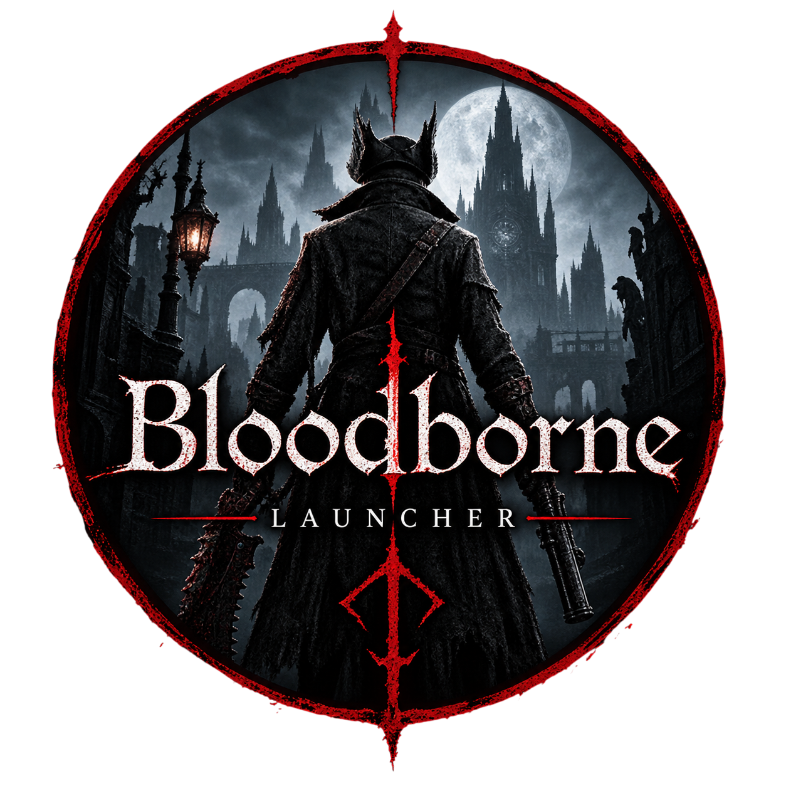

<div align="center">



# Bloodborne Launcher

Bloodborne PC portu için tek tıkla kurulan Windows yükleyici ve başlatıcı.<br />
Oyunu, v1.09 güncellemesini, portu ve çıkarıcıyı uygulama içinden indirir; kurulumu kendisi bitirir.

<br />

<a href="https://github.com/furylemonss/bloodborne-launcher/releases/latest"></a>
<a href="#gereksinimler"></a>
<a href="LICENSE"></a>
<a href="#lisans"></a>

<br />

<a href="https://v2.tauri.app/"></a>
<a href="https://www.rust-lang.org/"></a>
<a href="https://vite.dev/"></a>
<a href="#ne-yapar"></a>

<br />

[English](README.md) · [İndir](#indir) · [Ne yapar](#ne-yapar) · [Derlemek](#kaynaktan-derlemek) · [Lisans](#lisans)

</div>

---

## İndir

Kurulumu [en son GitHub Release](https://github.com/furylemonss/bloodborne-launcher/releases/latest) sayfasından alın.

| Dosya | Ne işe yarar |
| --- | --- |
| `Bloodborne Launcher_<sürüm>_x64-setup.exe` | NSIS kurulumu. Çoğu kişinin çalıştırması gereken dosya budur. |
| `Bloodborne Launcher_<sürüm>_x64_en-US.msi` | MSI paketi. Windows Installer tercih edenler için. |

Setup yalnızca bu launcher'ı kurar. Oyunun kendisini içermez. Launcher'ı açtıktan sonra bir klasör seçip kurulumu başlatırsınız. Geri kalan dosyaları uygulama indirir ve kurulumu kendi tamamlar.

---

## Bu nedir

Bloodborne PC launcher'larının çoğu, dump'ın, güncellemenin ve portun doğru klasörlerde hazır olmasını bekler. Bu beklemiyor. Launcher'ı bir kez kurarsınız, hedef klasörü seçersiniz. Uygulama gereken her dosyayı indirir, çıkarır, güncellemeyi uygular, port ayarlarını yazar ve sizi Oyna ekranına bırakır.

Launcher'ın kendisi küçüktür. Oyun verisi diskte yaklaşık 29 GB tutar. İndirilen set bundan büyüktür, çünkü PKG dosyaları ile çıkarılmış oyun, siz temizleyene kadar yan yana durur.

Proje açık kaynaktır. Paylaşılan şey launcher kodudur. Oyun, güncelleme, port ve PKG çıkarıcı bu depoyla dağıtılmaz. Kurulum sırasında her biri kendi mevcut açık adresinden indirilir.

---

## Ne yapar

Bir kurulum dokuz adımdan geçer. Bitmiş adımlar sonraki açılışta atlanır. Bağlantı kopunca her şey baştan başlamaz.

| Adım | Ne olur |
| --- | --- |
| Oyun PKG | GOTY ana paketi (yaklaşık 29,2 GB) Internet Archive'den iner. |
| Güncelleme PKG | CUSA03173 EUR v1.09 güncellemesi (yaklaşık 173 MB) iner. |
| Port | Portun son sürümündeki `Bloodborne-Windows.zip` iner. |
| PKG çıkarıcı | Windows için ShadPS4Plus PkgExtractor 1.1 iner. |
| Oyunu çıkar | Ana PKG, `downloads\CUSA03173` içine açılır ve dosya ağacı kontrol edilir. |
| Güncellemeyi çıkar | Güncelleme, `downloads\CUSA03173-patch` içine açılır. |
| Güncellemeyi uygula | Güncelleme ana oyunun üzerine birleştirilir, sonra yamanın oturduğu doğrulanır. |
| Portu aç | Port, `port` klasörüne çıkarılır. |
| Ayarları yaz | Oyunun açılabilmesi için varsayılan launcher ve port ayarları yazılır. |

Bundan sonra Oyna, `Play Bloodborne.exe` dosyasını başlatır. O yoksa port launcher'ına, o da yoksa `Bloodborne.exe` dosyasına düşer.

---

## Bu launcher'ın farkı

| | Bu launcher | Alışılmış launcher |
| --- | --- | --- |
| Oyunu edinmek | Uygulamanın içinde tek tık | PKG, yama ve portu elle indirmek |
| Çıkarma | Otomatik, dosya ağacı kontrolü ile | Ayrı bir çıkarıcı ve doğru kurulması gereken klasör düzeni |
| Güncelleme | Kendiliğinden uygulanır | Elle kopyalanır veya birleştirilir |
| Yarım kalan indirme | Parça dosyadan devam eder | Çoğu zaman baştan başlar |
| Yarım kalan kurulum | Son biten adımdan sürer | Yarı çıkarılmış bir ağaç bırakmak kolaydır |
| İlk açılış ayarları | Sizin için yazılır | Sonradan ini dosyalarından düzeltilir |
| Pencere | Çerçevesiz uygulama, tepsi, duraklat ve devam | Genellikle bir betik ya da araç klasörü |

Fark yeni bir port değildir. Oyun yine mevcut Bloodborne PC portu üzerinden çalışır. Bu proje yalnızca oraya varmayı otomatikleştirir.

---

## Gereksinimler

- 64 bit Windows 10 veya Windows 11
- Boş bir kurulum için yaklaşık 65 GB boş alan. Diskte bulunan dosyalar sayıldığı için devam eden bir kurulum daha az ister.
- Kararlı bir bağlantı. Ana paket yaklaşık 29,2 GB.
- WebView2. Güncel Windows 10 ve Windows 11 kurulumlarında zaten vardır. Pencere açılmazsa [WebView2 Evergreen Runtime](https://developer.microsoft.com/microsoft-edge/webview2/) yükleyin.

Disk kontrolü, hat başlamadan önce yapılır. Seçilen sürücü yetmiyorsa kurulum başlamaz.

---

## Kullanım

1. Releases'teki setup'ı çalıştırın ve **Bloodborne Launcher**'ı açın.
2. Oyunun duracağı klasörü seçin.
3. Boş alan değerini kontrol edin, sonra kurulumu başlatın.
4. Bırakın çalışsın. Duraklatabilir, devam ettirebilir veya pencereyi sistem tepsisine gönderebilirsiniz. Pencereyi kapatmak indirmeyi kesmez. Uygulama tepside kalır.
5. Hat Hazır durumuna gelince Oyna'ya basın.

İndirmeler `.part` dosyası olarak tutulur ve HTTP range istekleriyle sürdürülür. Beklenen boyuta uyan bir dosya yeniden inmez. Bağlantı koparsa aynı dosya, adım başarısız sayılmadan önce sekiz kez yeniden denenir.

Başarısız veya duraklatılmış bir kurulumu yeniden başlatmak güvenlidir. Tamamlanan adımlar tamamlanmış kalır. Yarım PKG çıkarmaları tekrar denenmeden önce tespit edilip temizlenir. Kesik bir oyun ağacı, bitmiş sayılmaz.

---

## Kurulum düzeni

Her şey seçtiğiniz klasörün içinde kalır.

```text
<kurulum klasörü>
├── downloads
│   ├── Bloodborne.Game.of.the.Year.Edition.PS4-PRELUDE.pkg
│   ├── CUSA03173-EUR-Update-v1.09-PRELUDE-[PS4ID].pkg
│   ├── Bloodborne-Windows.zip
│   ├── CUSA03173                 oyun dosyaları
│   └── CUSA03173-patch           çıkarılmış güncelleme
├── tools
│   └── ShadPs4Plus-PkgExtractor-1.1-windows
├── port                          PC portu
└── installer-state.json          ilerleme, kurulum buradan devam eder
```

Port ayarları iki yere yazılır:

- `port\bbport.ini` ölçekleyiciyi, kalite hazır ayarını ve çıkış çözünürlüğünü tutar.
- `%APPDATA%\bbport-launcher\settings.json` oyun yolunu, kayıt yolunu ve kare hızı kipini tutar.

İlk kurulum 90 FPS, FSR 4, Quality hazır ayarı ve 1920x1080 kullanır. Kayıtlar `Belgeler\Bloodborne\saves` altına gider.

---

## Ayarlar

Uygulamadaki ayar ekranından şunlar değişir:

| Ayar | Değerler |
| --- | --- |
| Oyun konumu | Çıkarılmış oyunu içeren klasör |
| Kayıt konumu | Kayıtların tutulduğu klasör |
| Kare hızı | 30, 60, 90 veya sınırsız |
| Ölçekleyici | FSR 4, FSR 3.1, DLSS, TAA veya kapalı |
| Kalite hazır ayarı | Portun kendi ölçeğinde beş hazır ayar |
| Çıkış çözünürlüğü | 1280x720, 1920x1080, 2560x1440, 3840x2160, 2560x1080, 3440x1440 |

Aynı ekranda iki temizlik grubu vardır.

Güvenli temizlik, yarım kalmış `.part` indirmelerini, geçici yama klasörünü ve inmiş çıkarıcıyı siler. Tamamlanmış oyunu silmez.

Sıfırlama grubu yıkıcıdır. İnen PKG ve zip dosyalarını silebilir, çıkarılmış oyunu da silebilir. İkisi de isteğe bağlıdır ve varsayılan olarak işaretli değildir. Onaylamadan önce satırı okuyun. Bulut kopyası yoktur ve bu launcher, sildiğiniz bir oyunu geri getiremez.

---

## Çalışırken

- **Duraklat / devam.** Sürmekte olan indirme, diskte biriken kısmı atmadan bekler. Çıkarma da iş birimleri arasında duraklatılabilir.
- **Tepsi.** Pencereyi küçültün veya kapatın, kurulum sürer. Tepsi menüsünden pencereyi geri getirebilir veya uygulamadan çıkabilirsiniz.
- **Bildirimler.** Kurulum bitince ve oyun süreci kapanınca sistem bildirimi gelir.
- **Güç sorusu.** Kurulum bitince uygulama, bilgisayarı kapatmayı veya yeniden başlatmayı önerebilir. Siz seçmeden bir şey olmaz. İki eylem ayrıca açık komut olarak da durur.

---

## Dosyalar nereden gelir

Launcher oyunu barındırmaz. Adresler `src-tauri/src/constants.rs` içine sabittir ve her parçanın kendi yayıncısını gösterir.

| Parça | Kaynak |
| --- | --- |
| GOTY ana PKG ve v1.09 güncelleme PKG | Internet Archive |
| Bloodborne PC portu (`Bloodborne-Windows.zip`) | `github.com/Supermedo/bloodborne_pc` son sürümü |
| PKG çıkarıcı 1.1 | `github.com/AzaharPlus/shadPS4Plus` |

Sürümler ve dosya boyutları sabitlenmiştir. Böylece yarım kalan bir indirme, olması gereken dosyayla karşılaştırılabilir. Yukarı akıştaki bir sürüm bu dosyaları değiştirirse sabitlerin de ona göre güncellenmesi gerekir.

---

## Kaynaktan derlemek

Tauri 2 araç zinciri gerekir:

- [Node.js](https://nodejs.org/) 20 veya daha yeni
- MSVC araç zinciri ile kararlı [Rust](https://www.rust-lang.org/tools/install)
- WebView2 ve Visual Studio C++ derleme araçları dahil [Windows için Tauri ön koşulları](https://v2.tauri.app/start/prerequisites/)

```powershell
npm install
npm run tauri dev
```

NSIS setup ve MSI dahil üretim derlemesi:

```powershell
npm run tauri build
```

Kurulum dosyaları `src-tauri\target\release\bundle\` altına yazılır. Arayüz, Vite ile paketlenen düz HTML, CSS ve JavaScript'tir. Kurulum hattı, indirmeler, çıkarma ve süreç denetimi Rust'tadır.

`tauri dev` oturumunun hata ayıklama kayıtları terminale düşer. İndirme, çıkarma ve birleştirme aşamaları başlarken, yeniden denerken ve bitirirken kısa bir satır basar.

---

## Proje düzeni

```text
src/                  launcher arayüzü
src-tauri/src/        Rust arka ucu
  commands.rs         pencere, oyna, durdur, temizlik ve ayar komutları
  pipeline.rs         dokuz adımlık kurulum
  download.rs         sürdürülebilir ve yeniden denemeli parçalı indirme
  extract.rs          PKG çıkarma, zip çıkarma, güncelleme birleştirme, ayarlar
  constants.rs        kaynak adresleri, dosya adları ve beklenen boyutlar
public/               logo.png dahil durağan görseller
```

---

## Katkı

Sorun bildirimleri ve çekme istekleri açıktır. İşe yarar bir raporda Windows sürümü, kurulum klasörü, başarısız olan adım ve hata şeridindeki metin bulunur. Kurulum klasöründeki `installer-state.json`, hangi adımların bittiğini tutar.

Oyun PKG'sini, güncelleme PKG'sini veya başka telifli oyun verisini depoya ekleyen çekme isteği göndermeyin. Bu dosyalar uzakta kalır.

---

## Sorumluluk reddi

Bloodborne, Sony Interactive Entertainment'ın ticari markasıdır. Bu proje bağımsız bir açık kaynak yükleyicidir. Sony, FromSoftware veya PC portu ile PKG çıkarıcının yazarları ile bağlantılı değildir, onlar tarafından onaylanmaz ve desteklenmez.

Oyun verisini nasıl edindiğinizden ve nasıl kullandığınızdan siz sorumlusunuz. Launcher, herkese açık bağlantılı dosyaları indirip makinenize kurar. Oyunun lisansını vermez.

---

## Lisans

Launcher kaynağı [MIT Lisansı](LICENSE) ile yayınlanır.

Kurulum sırasında indirilen üçüncü taraf yazılımlar kendi lisanslarını korur. Bloodborne PC portu, ShadPS4Plus PkgExtractor ve oyun paketleri bu deponun lisansına girmez.
